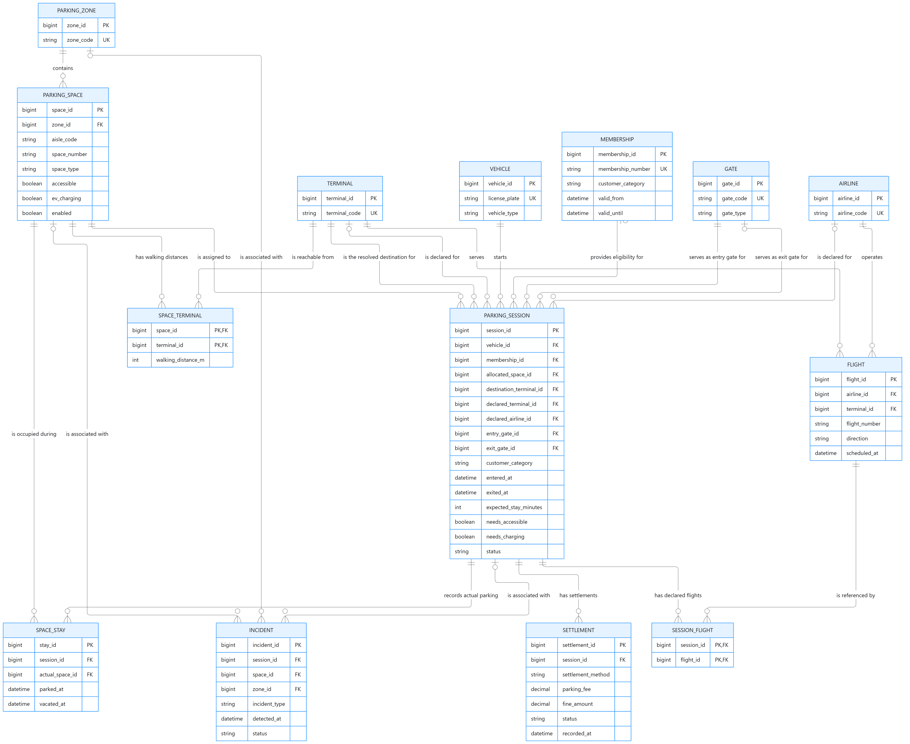
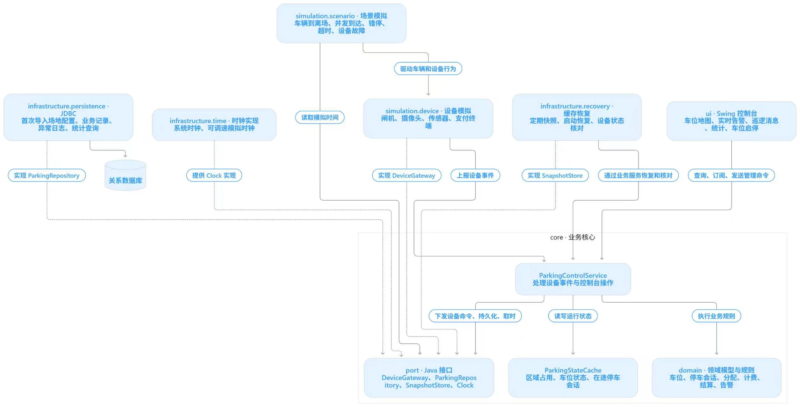

# 项目开发与课程交付约定

<!-- Team 7: Hao Yang, Zexuan Li, Haolin Chen. -->

本文件指导本项目的开发、阶段汇报和最终打包。课程要求以最新的项目说明和 eLearning 提交说明为准；`description.md` 是机场停车管理原型的功能要求。不要把本文件当成课程最终提交材料。

## 项目与技术约束

- 项目是 MIA（Major International Airport）机场停车管理的原生桌面原型，不做 Web 应用。
- 使用纯 Java，不使用 Spring Boot、Hibernate 等应用框架。图形界面仅使用 JDK 自带 Swing 或 JavaFX；优先采用 Swing，除非项目设计明确选择 JavaFX。
- 使用 JDBC 访问 MySQL。提交可导入 MySQL 的完整 `db.sql`，包含所需数据库结构和演示初始数据。
- 参考已完成项目为 IntelliJ IDEA 单 Java 模块、Java 21，并使用 MySQL Connector/J 5.1.47。可将此作为起点，但依赖版本须与实际 JDK、MySQL 服务端兼容；最终在 README.txt 中写明实际 JDK、驱动版本及安装/运行要求。不要无故添加第三方框架或依赖。

## 课程设计的实现原则

- 本项目只是学校课程设计级别的原型，不是商业部署或专业级生产系统。目标是基本满足课程要求和 `description.md`，并能清楚演示主要流程。
- 优先采用直观、易读、方便组员理解、实现和验证的方案；不为追求专业化或先进性增加复杂架构、复杂算法、企业级兜底措施或不必要的依赖。
- 仅在课程要求或 `description.md` 明确需要时，才增加相应的类、接口、配置、校验和异常处理。模块联调优先使用简单接口、内存样例和清楚的流程。
- 简化设计不代表省略课程或需求文档明确规定的功能与交付材料；如某项明确要求本身较复杂，按要求完成其基本可演示实现即可。
- 示例适配器和简化规则必须明确标为演示用途；最终实现应由对应模块负责人按 `description.md` 补齐。

## 开发目录与归档

项目保持一个 Java 模块，源码按职责拆分成小写 package，并保持 package 路径与源码目录一致。依据应用职责组织代码，例如入口/应用协调、停车场领域模型、分配与计费服务、数据库访问、界面、设备与流程模拟、缓存等；只建立实际需要的 package。

```text
项目根目录/
├── src/                    # Java 源码，按 package 层级保存
├── lib/                    # 外部 JAR，例如 MySQL JDBC 驱动
├── docs/                   # 项目文档与需求参考资料
│   ├── AGENTS.md           # 开发约定，不作为六项最终材料之一
│   ├── description.md      # 项目需求文档
│   ├── 老师的要求.md       # 课程要求和交付说明
│   └── assets/             # docs 中引用的项目图示
│       ├── airport-map.png
│       ├── placement-system.png
│       ├── parking-system-architecture.jpg
│       └── 5ed3258104af611c8e171ef647c94df1.png  # 第一次课堂提交中的 ER 图
├── files/                  # 最终运行所需的配置、数据和资源
├── db.sql                  # 可导入 MySQL 的数据库脚本
├── README.txt              # 安装、配置、运行和目录说明
└── ...                     # 其他项目文件
```

`docs/description.md` 是项目需求文档；`docs/老师的要求.md` 记录课程与交付要求。`docs/assets/airport-map.png` 和 `docs/assets/placement-system.png` 是需求文档关联的参考图示。维护目录时保留这些相对路径，文档和图示的具体内容以原文件为准。

根据实际程序需要增删目录。运行时资源应能从提交包中的相对路径读取，不得依赖个人电脑上的绝对路径或 IDE 工作目录。最终 `files.zip` 中必须保留名为 `files` 的主文件夹及其子目录结构；`sources.zip` 只放 Java 源文件并保留 package 结构，不要加入 `.idea/`、`out/` 或编译产物。

## 团队协作与阶段提交

- 团队原则上由三名学生组成；仅在全班人数不能被三整除时允许一或两组各由两人组成。确定队友后不得更换。每组指定一名组长。
- 组长负责步骤 1–3 的课堂材料和最终材料，并将全部材料上传至自己的 eLearning 上传目录。其他组员不得向平台上传材料。
- 每个文件顶部都要列出全体组员姓名：Team 7 的 Hao Yang、Zexuan Li、Haolin Chen。对支持注释的源码使用文件注释；对不支持源代码注释的文档或二进制格式，使用该格式允许的首页、说明区或元数据标明组员。不要虚构或擅自替换组员姓名。
- 步骤 1：提交设计讨论报告，说明需求理解、架构、策略和组内任务分工；可附初步代码。报告优先使用 PDF。
- 步骤 2：提交本阶段总结，说明设计决定和相对步骤 1 的变化，并上传本阶段全部代码（包括未完成或有缺陷的代码）；代码需充分注释。
- 步骤 3：提交本阶段总结，逐项说明相对步骤 2 的变化，并上传本阶段全部代码；代码需充分注释。
- 步骤 4：完成项目并提交最终六项材料。每个阶段按要求及时由组长上传，不要等到截止前才整理或验证。

## 最终六项材料

最终提交必须包含以下六项，文件名保持精确：

1. `README.txt`：纯文本安装与运行说明，解释全部文件和目录，列出 JDK/MySQL 要求、数据库导入方式、访问数据库所需凭据，以及运行命令和参数。
2. `sources.zip`：全部 Java 源文件，保留源码目录与 package 层级。
3. `project.jar`：可执行 JAR，必须可通过 `java -jar project.jar` 启动。
4. `files.zip`：包含主目录 `files/` 及所有运行所需配置、数据和资源，并保留目录结构。
5. `db.sql`：完整且格式正确、可导入 MySQL 的数据库 SQL 文件。
6. `project-report.pdf`：填写完整的 PDF 项目报告，并在报告中提供 Youku 视频链接。

另需制作 15–18 分钟的 Youku 演示视频，每位组员都要发言约 5–6 分钟。视频由 Youku 链接提供，链接写入项目报告；最终六项上传材料中不单独增加视频文件。

## 打包与质量要求

- README 的运行命令必须与最终交付内容一致；JAR、`files.zip` 解压后的 `files/`、`db.sql` 和凭据配置应能配合工作。若程序需要 `main` 参数，README 给出完整示例。
- 完整数据库脚本需能在 MySQL 中导入；仅有建表语句而缺少运行演示所需数据时，补充适量可重复导入的初始数据。
- 打包后从交付目录验证：导入 `db.sql`、配置数据库凭据、运行 `java -jar project.jar`，并确认界面、资源和主要流程正常。再请队友在另一环境复核。
- 质量优先于功能数量：先让已实现的流程稳定、输入校验完整、错误处理清楚，再扩展功能。类和方法应职责明确，避免过长方法；充分注释阶段代码和需要解释的设计选择。
- 代码设计应体现对面向对象结构的合理运用：根据领域职责设计类；在存在可替换的共同契约时使用接口或抽象类；在确有“是一种”关系时使用继承，并通过多态减少不必要的类型判断。不要为凑数量而添加没有实际作用的抽象或继承层级。
- 按职责组织 package，合理选择控制结构和数据结构，使其符合业务逻辑与数据操作方式。
- 类、方法和变量使用有意义且一致的名称；优先采用直观、简洁、容易阅读和维护的实现，避免不必要的复杂度。
- 功能性 Java package 使用 `package-info.java` 或类级 Javadoc 简要说明模块职责；新增或修改的功能类用类级注释说明其基本作用。`db.sql` 在数据库、表和样例数据等主要区段写明用途，不要求逐行复述显而易见的代码或 SQL。

# 需求说明与分工

依据 [项目需求](description.md) 和 [老师的补充说明](老师的要求2.md)。每项功能实现后，由负责人将 `[ ]` 改为 `[x]`。

## 组员一 · 车位分配与停车计费

- [ ] 处理入口请求，识别车牌、车型和尺寸、用户类别及订阅，按出发或到达航班、航站楼或航空公司确定目的地，并在信息缺失时提供兜底分配。
- [ ] 按车位类别、用户资格、无障碍与充电需求筛选车位，结合航班紧迫度、接机需求和超过 3 天的长停需求排序，并在车流集中时分散相邻车辆。
- [ ] 在实时内存缓存中维护车位状态，并发分配时避免重复分配。分区占用率达到 80% 时发布告警，达到 90% 时暂停向该区分配并引导至其他区。
- [ ] 返回指定车位及从入口到车位的文字路线，并提供前往合适出口的路线，支持指定出口。
- [ ] 根据设备事件记录停入和驶离时间、释放车位，并核对车牌与指定车位。判定错停、无障碍车位违规、场内行驶超时、停车超时及设备故障，发布状态与告警，执行设备故障时的自动停用以及控制台的车位启停命令。
- [ ] 按实际占用车位的时间计算阶梯小时价、阶梯日价、周套餐和超周组合价，处理各类用户折扣及专业运输月包的单次停留限制。
- [ ] 处理出口识别、罚款入账和结算放行，支持临时用户数字支付、适用用户自动扣款及专业运输月包。

## 组员二 · 控制中心、日志与恢复

- [ ] 制作 Swing 控制台，按区和车位组展示空闲、待停入、已占用、错停、超时和停用状态，并可查看车牌、航班和订阅等详情。
- [ ] 在页面顶部提供“中文 / English”切换，默认中文；切换后立即更新整个控制台的导航、标题、看板、状态、告警和占位页文案，并保留当前页面与数据。语言选择只在本次运行期间有效；车牌、区域编号等业务值原样显示。
- [ ] 实时展示全场、各区和各车位组的占用率及剩余车位，接收并向控制中心和巡逻人员转发分区占用率告警。
- [ ] 向控制中心和巡逻人员展示或转发错停、无障碍车位违规、场内行驶超时、停车超时和设备故障等告警。接收巡逻回报并交由业务服务判定是否计入结算。
- [ ] 在控制台提供车位手动停用与恢复入口，向业务服务发送启停命令，并显示设备故障及车位自动停用结果。
- [ ] 负责 MySQL、JDBC 和 `db.sql`，首次部署时导入场地配置和演示航班数据，并持久化基础数据、车辆进出闸记录、车位分配、实际占用时间及异常事件。
- [ ] 提供分时占用率、航站楼到访量及入口到车位、车位到出口的平均用时统计。
- [ ] 定期备份实时缓存。重启时通过业务服务恢复快照并查询设备状态进行核对，确保车流记录及未结束的停车过程可继续追踪。

## 组员三 · 设备模拟、场景与统一时间

- [ ] 实现可替换的 `DeviceGateway`，模拟进出闸机、摄像头、采集终端和支付终端，支持向业务服务上报采集结果、接收路线及执行开闸指令。
- [ ] 模拟车位传感器和摄像头，支持停入、驶离、启停、故障自检及重启后的车位状态查询。
- [ ] 实现全系统共用的 `Clock` 接口，提供正常速率时钟和时间压缩比可调的模拟时钟。
- [ ] 提供可编辑的停车场布局配置，覆盖闸机、航站楼、分区、车道、车位和距离关系，交由组员二在首次部署时导入。
- [ ] 提供可调整时刻、航空公司和航站楼的到达及出发航班演示数据。
- [ ] 模拟可配置的并发车流、到达频率、分区分布、停车时长和异常，按距离模拟入口到车位及车位到出口的行驶时间。
- [ ] 准备可复现的正常停车、集中到达、错停、超时、设备故障及强制停止 JVM 后重启的演示场景。

联调时，组员一维护业务服务和核心接口，三位组员共同确认接口契约。组员二接入业务服务并提供持久化和快照实现。组员三提供设备和时钟实现，以及场地配置和演示数据。各模块可用样例数据、设备事件或替身接口独立验证。

### 并行开发约定

- 开始模块实现前，三人先共同确认 `core.domain` 的共享记录/枚举和 `core.port`、`ParkingControlService` 的方法签名。组员一维护这些共享契约；其他成员先提出变更并共同确认，再由组员一更新，避免三人同时改同一接口文件。
- 组员一主要写 `core` 与 `core.domain`；组员二主要写 `ui`、`infrastructure.persistence`、`infrastructure.recovery` 及 `db.sql`；组员三主要写 `simulation` 和 `infrastructure.time`。跨目录修改先通知对应负责人。
- `core` 只依赖领域类型和端口，不直接依赖 Swing、JDBC 实现或模拟器。`ui` 通过 `ParkingControlService` 工作；JDBC、恢复、设备和时钟模块通过实现端口接入。
- 每个模块可使用样例数据或简单替身独立编译和演示。集成基线使用 `InMemoryParkingRepository`、`InMemorySnapshotStore`、`SimulatedDeviceGateway` 和 `SystemClock`；`DemoParkingControlService` 的分配和收费规则只是临时示例，不代表最终业务规则。
- 当前团队按共享项目目录和职责目录协作，不要求建立 Git 流程。集成时由三人共同运行根目录的 `build.ps1`；变更共享接口前先同步其他成员。
- 最低集成标准：所有源码可由 JDK 21 编译；应用可在没有 MySQL 的情况下通过内存适配器启动；核心入场、设备事件、出场和看板数据使用同一组共享类型。无需为脚手架引入复杂测试框架。

## ER 图与数据库模型基线

以下 ER 图沿用[第一次课堂提交中的 “MIA Parking Management System ER Diagram”](第一次课堂提交.md#mia-parking-management-system-er-diagram)，是持久化模块和 `db.sql` 的初始设计基线。



- 场地布局由 `PARKING_ZONE`、`PARKING_SPACE` 和 `TERMINAL` 描述；`SPACE_TERMINAL` 关联车位与航站楼，并保存步行距离。车位实体还记录车位类别、无障碍、充电和启用属性。
- `VEHICLE` 对应多次 `PARKING_SESSION`；会话记录会员及用户类别、分配车位、申报或解析出的航站楼/航空公司、入口与出口闸机、预期停留和需求标记。`FLIGHT` 关联航空公司和航站楼，`SESSION_FLIGHT` 关联会话与航班。
- `SPACE_STAY` 将会话与实际占用车位及停入/离开时间关联，须与会话中的分配车位区分。`INCIDENT` 关联相关会话、车位或分区；`SETTLEMENT` 记录会话的结算方式、停车费、罚款、状态和时间。
- 实现数据库时以该图的实体职责和关系为基线，并同时满足需求文档；在 `db.sql` 中落实字段类型、约束和演示初始数据，不要把“分配车位”与“实际停放车位”合并成一个关系。

## 整体项目结构与模块说明



| 模块 | 负责人 | 职责 |
| --- | --- | --- |
| `core` | 组员一 | 整合业务服务、运行状态、领域规则和 Java 接口，协调停车、结算与异常处理。 |
| `ParkingControlService` | 组员一 | 接收设备事件和控制台查询、订阅及管理命令，执行领域规则，更新缓存，下发设备指令，并协调数据读写与恢复。 |
| `ParkingStateCache` | 组员一 | 在内存中维护分区占用率、车位状态和进行中的停车会话，供分配、监控和恢复使用。 |
| `core.domain`（图中 `domain`） | 组员一 | 定义车位和停车会话模型，以及车位分配、占用计费、结算和告警规则。 |
| `core.port`（图中 `port`） | 组员一维护，三人确认接口契约 | `DeviceGateway` 用于设备指令和状态查询，`ParkingRepository` 用于业务数据读写，`SnapshotStore` 用于缓存快照，`Clock` 提供统一时间。共享方法签名见对应 Java 接口。 |
| `ui` | 组员二 | 提供 Swing 控制台，通过业务服务查询车位与统计、订阅实时状态和告警、查看及登记巡逻消息，并提交车位启停命令。 |
| `infrastructure.persistence` | 组员二 | 用 JDBC 实现 `ParkingRepository`，负责首次部署的数据导入、停车业务记录与异常日志的持久化，以及历史统计查询。 |
| 关系数据库（MySQL） | 组员二 | 保存场地、航班和用户等基础数据，以及进出闸、车位分配、实际占用和异常等业务记录。通过 `db.sql` 提供结构及演示初始数据。 |
| `infrastructure.recovery` | 组员二 | 实现 `SnapshotStore`，定期保存缓存快照，重启时通过业务服务恢复运行状态并核对设备上报的当前状态。 |
| `infrastructure.time` | 组员三 | 实现正常速率的系统时钟和可调速的模拟时钟。业务服务和场景模拟统一通过 `Clock` 获取时间。 |
| `simulation.device` | 组员三 | 实现 `DeviceGateway`，模拟闸机、摄像头、传感器和支付终端，执行开闸、启停等指令并上报车牌、停入、驶离、支付结果和故障。 |
| `simulation.scenario` | 组员三 | 读取统一时钟，按场景配置驱动模拟设备，复现车辆到离场、并发到达、错停、超时及设备故障。 |

场景模块驱动模拟设备，设备向 `ParkingControlService` 上报事件。业务服务执行规则并更新缓存，再通过接口下发命令、保存记录和发布状态。控制台通过业务服务查询、订阅和提交管理命令。恢复模块在启动时通过业务服务恢复快照，并通过 `DeviceGateway` 查询设备的当前状态进行核对。
