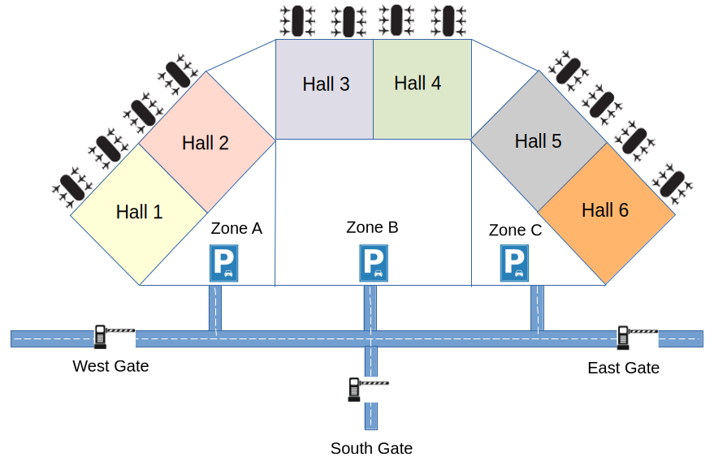
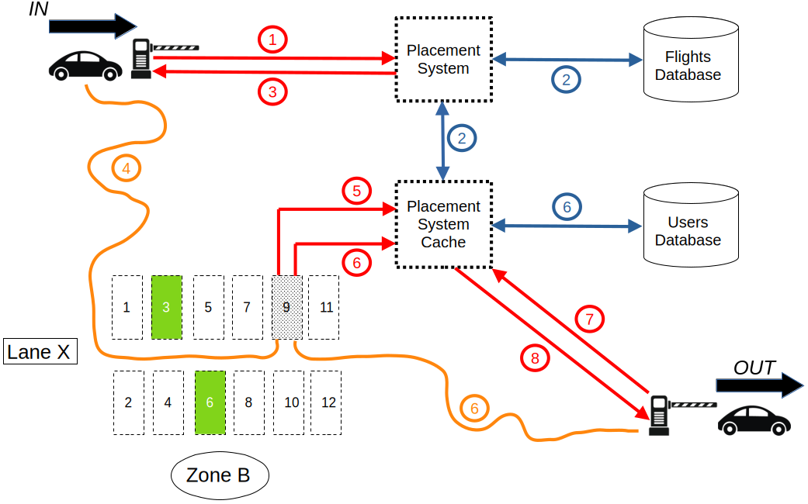

## Project description

### ***Preliminary remarks***

*This project is above all an exercise that wraps up the Advanced Java course. It is in this spirit that the following rules must be (strictly) applied:*

- *you are to use plain Java and NO framework of any kind (like Spring Boot, Hibernates, etc.)*
- *for any Graphical User Interface, you are to use plain Java Swing or JavaFX*
- *although you're allowed to use AI, you should design most of the logic and architecture of your application yourself, and use AI only to help you on specific part*
- *although you're free on how to organize your work, you're strongly encouraged to take this opportunity to do real team work: do your best to share the work between team members!*

### **Introduction**

A major international airport—referred to here as MIA (Major International Airport)—has issued a call for tenders for the development of an IT system to manage its vast parking facilities. Your software development company has decided to submit a bid, and your team has been tasked with analyzing the project and building a prototype to help secure the contract. As developing this prototype represents a significant investment, your company requires the code to be sufficiently generic, ensuring it can be easily adapted for other airports or similar entities, such as large shopping centers. You are to produce a prototype to be demonstrated before airport managers and department heads, who will select the best software solution. This prototype must closely resemble the final application and simulate components involved in a physical, real-world deployment—such as cameras, sensors, payment terminals, and user interactions. In particular, the graphical user interface must be highly polished and as close as possible to the final version. Similarly, the database structure must closely mirror the intended final architecture. For security reasons, the parking management and control system must be a native application, and it cannot be a web-based application.

### **The Context**

MIA is one of the largest airports in the world, with a parking facility that includes approximately 10,000 spaces. A wide variety of vehicles—such as cars, commercial vehicles, and motorcycles—enter and exit the facility 24 hours a day, 7 days a week. The current management of the parking area presents several efficiency and security challenges, and its existing computerization is only very rudimentary. The access and payment systems are obsolete and in need of replacement with modern technology. By utilizing sensors, cameras, and voice-enabled kiosks, the airport aims to implement a sophisticated management and control system to automate and optimize the use of the parking facility, while simultaneously enhancing security.

#### Users

The airport distinguishes between several types of users:

- Occasional user: An occasional user utilizes the parking facility sporadically to drop off or pick up a traveler.
- Subscriber: The airport offers various subscription plans. Subscribers do not pay for their parking duration upon exit; the amount is automatically debited from their bank account. They also enjoy several benefits, including a discount on parking rates.
- Airport employee: Like subscribers, airport employees do not pay for their parking duration upon exit; the amount is automatically debited from their bank account on a monthly basis. They also benefit from several advantages, including preferential parking rates and a near-guarantee of finding a space, thanks to designated reserved areas.
- Airline staff: Similar to airport employees, airline staff benefit from preferential parking rates and a guarantee of finding a space, thanks to designated reserved areas.
- Professional transport operators: This category includes hotel shuttles and private transport companies. Access to the parking facility is available exclusively through a flat-rate subscription. In other words, once identified, these vehicles can enter and exit the parking facility without needing to make a payment.

#### Parking Spaces

Parking spaces are organized into several categories:

- General-use spaces: This category comprises the largest number of spaces. They are available to both occasional users and those with subscriptions. This category is further subdivided into spaces for cars and spaces for motorcycles.
- Reserved spaces: These are available exclusively to airport employees.
- Airline staff spaces: These are available exclusively to airline personnel.
- Spaces for commercial/utility vehicles: Vehicles exceeding a certain size—such as small vans or minibuses—are classified as commercial/utility vehicles and are assigned designated spaces.
- Long-term parking spaces: These are intended primarily for stays exceeding 3 days and are generally grouped together in a specific area of the parking facility.

Within the general-use and reserved categories, there are designated spaces for individuals with disabilities (these spaces are more spacious and are typically located close to the halls and terminals). Furthermore, across the aforementioned categories, there are specialized spaces for electric vehicles, equipped with charging stations.

#### Parking Zones

All parking spaces are organized into zones. Each zone contains the various types of parking spaces described earlier, with the same proportions maintained across every zone. A given zone is located near one or more specific terminals, and each zone provides access to one or more of these terminals. Each terminal consists of an arrivals level and a level for check-in and boarding areas. Different airlines are distributed among the various terminals. However, there is no guarantee that a specific airline will always operate out of the same terminal. Below is a schematic map of MIA Airport:

#### Parking rates

Parking rates (and, as we shall see, parking locations) depend on the duration of the stay. For your prototype, you must account for the following four rate structures:

- Less than 24 hours: a sliding-scale hourly rate.
- 1 to 3 days: a sliding-scale daily rate.
- 1 week: a flat, fixed rate.
- More than 1 week: a combination of the aforementioned rates (for example, 2 weeks plus 2 days).

Rates are the same for all users (with the exception of professional transport operators), though certain user categories are eligible for discounts:

- Occasional users pay the full rate.
- Subscribers receive a 20% discount off the full rate.
- Airport employees receive a 50% discount off the full rate (for stays of less than 24 hours).
- Airline staff receive a 50% discount off the full rate (regardless of the duration).

Professional transport operators have a monthly flat-rate plan that allows for unlimited parking, provided that no individual stay exceeds 24 hours.

#### Access and Parking Allocation

Access to the parking facility (entries and exits) must be fully automated and operate without any human intervention. Specifically, the airport intends to eliminate parking booth attendants. The planned procedure is as follows: upon entry, a camera reads the vehicle's license plate and determines the vehicle's dimensions. At the exit, another camera reads the license plate again, allowing the system to calculate the fee based on several parameters (duration of stay, vehicle type, user category, and time period). Occasional users must pay the fee upon exit using a digital payment method (bank card, mobile device, or subscription card) and cash is no longer accepted. Parking allocation is **NOT** left to the user's discretion: the system assigns a specific parking space to each user, regardless of their category. Upon entry, users are required to provide at least one of the following pieces of information:

- A departing flight number
- An arriving flight number
- A terminal/concourse destination
- An airline

Additionally, users may provide one or more of the following:

- A subscription number, if applicable (for regular subscribers, airport staff, or airline personnel)—this can be read at the barrier (via a badge or barcode)
- The intended duration of the stay (default is less than 24 hours)
- A requirement for a charging station (default is "no")
- A requirement for an accessible (disabled) parking space

This information can be captured through various systems (such as QR code scanning, OCR, or voice recognition). Based on this data, **the allocation system will assign an appropriate parking space** in the area closest to the relevant terminal or concourse. The vehicle then travels to its assigned space and parks. A sensor and a camera located at the parking space detect the vehicle's arrival, capture its license plate once more, and confirm that it is parked. The billable parking duration begins at this moment. When the vehicle leaves the space, the sensor detects its departure, and the billable parking duration ends. In other words, the user is charged for the time elapsed between the moment the vehicle is parked and the moment it leaves the space—excluding the time taken to travel from the entrance to the parking space, and from the parking space to the exit. The process described above is illustrated in the following figure:

In this figure, the red connections represent communications between physical devices (cameras, sensors, data-acquisition terminals) and the software, while the blue connections represent software interactions between the various modules. The steps can be broken down as follows:

- Step 0: Bill drives his friend Joe, who is going on a trip, to the airport.
- Step 1: Bill arrives at the parking lot entrance. The camera captures his license plate number and transmits it to the parking allocation system, along with the flight number for Joe's departure.
- Step 2: Using flight information (retrieved from a database) and having selected an optimal parking space (via a cache that stores all parking spots in appropriate data structures), the allocation system notifies the cache that the space has been assigned, the cache then marks it as "pending" (in this case, space B-X9—"Zone B, Aisle X, Spot 9").
- Step 3: The allocation system sends the space number (along with directions on how to reach it) to Bill, the barrier opens, and Bill enters the parking lot.
- Step 4: Bill drives to the assigned parking space (B-X9).
- Step 5: Bill parks his vehicle. A sensor triggers the camera, which sends the license plate number to the cache, the cache then confirms the allocation and marks the space as "occupied." The parking duration begins.
- Interlude: Bill and Joe head to the departure hall and have a coffee while waiting for boarding.
- Step 6: After wishing Joe a pleasant trip, Bill returns to his vehicle and leaves the parking space. The sensor notifies the cache that the vehicle has departed. The cache marks space (B-X9) as "available." The parking duration timer stops. Using information from the user database (for instance, checking if Joe is a subscriber), the cache calculates the parking fee for Joe.
- Step 7: Joe arrives at the parking facility exit. A camera captures his license plate number and transmits it to the cache.
- Step 8: The cache sends the amount due to the exit barrier. Joe pays for his parking, the barrier opens, and he exits the facility.

The vehicle placement system aims to optimize traffic flow within the parking facility. For example, if several vehicles arrive simultaneously for the same area, the system assigns them spaces sufficiently far apart so that they do not interfere with one another while parking. The system also optimizes vehicle placement based on time: if a user arrives and their flight departure is imminent, the system attempts to assign them a space as close as possible to the entrance of the relevant terminal. Conversely, if there is plenty of time before departure—or if the user is arriving to pick up someone from an incoming flight—the system assigns a space further away from the terminal entrance. Finally, any long-term parking (exceeding 3 days) results in the vehicle being directed to the "long-term parking" section, which is located at a greater distance from the terminal access points.

#### Security

The airport in general, and its parking facility in particular, are highly sensitive areas that require constant vigilance. The parking area is managed and monitored around the clock by staff in the **control center**. From this location, personnel have a comprehensive view of all activity within the parking facility and the status of individual spaces, allowing them to quickly detect any irregularities. Mobile security personnel, equipped with electric scooters, continuously patrol the parking aisles. In constant radio contact with the control center, they can respond rapidly to assist users in need or resolve any issues. **The vehicle placement policy is strictly enforced**: vehicles must occupy the specific spaces assigned to them. If a vehicle parks in a space other than the one allocated, the parking management system immediately alerts both the control center and the mobile security team. A staff member is then dispatched to the scene to instruct the user to vacate the unauthorized space and move to their correctly assigned spot. Should a user manage to evade the mobile security team, they will be required to pay a significant, deterrent-level fine upon exit, in addition to their standard parking fees. Mobile security personnel are also tasked with regularly verifying that spaces reserved for individuals with disabilities are used exclusively by those for whom they are intended. If an unauthorized vehicle occupies a reserved space, the mobile agent reports it, and the offending user is issued a substantial, deterrent-level fine. The system is designed to detect all types of anomalies: for instance, if a vehicle enters the parking facility but fails to reach its assigned space within a set time-frame, the system immediately notifies the control center and the mobile security team so that they can locate the vehicle. The time-frame in question can be estimated quite precisely by the parking guidance system, which can easily calculate the distance between the entrance used by a vehicle and the space it is intended to occupy. The same logic applies to a vehicle leaving its parking space that fails to reach the exit within a specified period.

Another type of anomaly that the management system must detect relates to parking duration. If a user remains in a parking space beyond the time limit selected upon entry, the system notifies the control center and mobile staff, prompting them to visit the location to check for any issues. In such cases, the user will be required to pay a significant, deterrent fine at the exit, in addition to their parking fee.

The occupancy rate of each parking zone is continuously monitored and displayed on the control center dashboard. When a zone's occupancy reaches 80%, the system alerts the control center and mobile staff, who then remain on standby to prevent traffic congestion within the facility. When occupancy reaches 90%, access to that zone is automatically suspended, and users are directed to other available parking areas.

Since some parking spaces may occasionally become unusable—for instance, due to damage requiring repairs—it must be possible to deactivate (and reactivate) individual spaces from the control center. The cameras and sensors associated with each parking space feature a self-test mode, allowing them to transmit a specific alert in the event of a malfunction. Upon receiving such an alert, the system automatically deactivates the affected space and displays a notification on the control center dashboard.

### **Application requirements**

#### Defining and Entering Parking Spaces

When the software is first deployed, the system must record the zones, their associated halls, and all parking spaces, along with their specific characteristics (zone, aisle, space number, parking type, distance to the various halls, etc.). This static data must be described in text files following a specific format. Once the system reads this data, it is also populated into the appropriate database tables. These text files are used only during the initial software deployment. Regarding the file format, you may choose between text files for which you define the structure yourself, or files in JSON or XML format.

#### Dashboard

Airport personnel working in the parking lot control room must have a complete, real-time view of the parking lot. You must therefore develop a graphical dashboard allowing you to visualize the traffic in the car park, as well as all the events relating to it. For example, the dashboard continuously displays the occupancy rate of the different groups of spaces, in the different zones, as well as the overall occupancy rate by zone and for the entire car park. The dashboard must make it possible to visualize a given group of parking places in a given area, using an intuitive display. For example, a place can be represented by a small rectangle: when the rectangle is black, the place is temporarily unusable. When the rectangle is gray, the space is free, when it is flashing green, the space has just been allocated, but the vehicle is not yet parked and when the rectangle is solid green, the vehicle is parked. If a vehicle parks in a space that has not been assigned to it, the rectangle is red. Finally, when a place remains occupied beyond the maximum authorized time, the rectangle turns orange. When a rectangle is green (flashing or solid), red or orange, it is possible, for example by clicking on it, to bring up a window containing all the information relating to this user (registration number, flight number, subscription, etc.). All anomalies mentioned above must be reported and must appear in real time on the dashboard. The dashboard also displays messages sent by mobile agents. You have complete freedom for the conception and design of this dashboard, and **its quality will be decisive in the process of selecting the best project by the airport management**.

#### Logging and statistics

All traffic relating to the parking lot is recorded in a database. The use of the parking lot by a user generates the following data:

- parking entrance used (for example EAST, WEST or SOUTH in the previous diagram) and the date and time of crossing the barrier
- the vehicle registration number
- information provided by the user (flight number, destination hall, airline)the user's destination hall
- the area and number of the assigned parking space
- the exact time of placement of the vehicle in the parking space
- the exact time of departure from the parking space
- the parking exit used, and the date and time of crossing the barrier

Using this data, it should be possible to produce various statistics on parking use, for example:

- parking occupancy rate (overall or by zone) depending on the time of day
- hall attendance rate (overall or per hall) per day or per month
- average time to reach the parking space from the entrance barrier, and from the parking space to the exit barrier

Likewise, all anomalies are recorded in a database.

#### Backup

In the event of an application crash, the data present in the database is naturally saved and can be restored when the application restarts. However, not all data used by the application is necessarily in the database. This is the case for data present in the cache at any given moment. It is therefore crucial to provide a system for periodically backing up cache data, so that the application can be restarted in the same state it was in before the crash. For example, one can imagine that a process is launched in the background when the application starts, and that process updates the cache backup at fairly short intervals (every minute, for example). Another recovery process could include the refresh of the parking slots state: after restarted from a crash, the system could send a specific signal to all the parking slot devices (camera, sensors) to retrieve their current state (free, occupied, license plate, etc.). You have complete freedom to imagine the format of the backup and the mechanism for restoring the data.

### **Simulation**

The application requested by MIA Airport consists of a "physical" component (access barriers, terminals, cameras, sensors, and their network connectivity) and a purely software-based component (the management and parking space allocation system). To participate in the call for tenders, you must develop a complete prototype of the application, which must include the following three parts:

- A software component: The core of the application, responsible for allocating parking spaces, monitoring, and managing the database.
- A "physical" component: This part must simulate the barriers, cameras, and sensors, as well as their connection to the parking management system.
- An "events" component: This part must simulate how users interact with the parking facility over time (e.g., arriving at the entrance barrier, driving to a parking space, etc.), as well as specific incidents within the facility, such as the failure of a camera or a sensor at a parking space.

The most important thing about the simulation is this: the code (classes, threads) that handles the simulation of physical elements (barriers, sensors, cameras) must be **completely separate** from the core of your application, and it should be easy and quick to replace it with the actual 'drivers' of these physical elements once the application is deployed. In other words, there shouldn't be any simulation code intricate in the application code!

##### Data Acquisition Devices

You must simulate the parking facility's entrance and exit barriers. A barrier can capture several types of information:

- At both entry and exit: The vehicle's license plate number.
- At entry only: One or more of the following: flight number (for departures or arrivals), terminal/concourse, airline, and—optionally—the expected parking duration (default: less than 24 hours) and a request for a space with a charging station (default: "no").
- At exit only: Payment for the parking duration.

Once this information is captured, it is transmitted to the central system. The entrance and exit barriers must also be capable of receiving "open" commands from the central system, triggering the barriers to open and allow vehicles to enter or exit. You must also simulate the devices associated with the parking spaces. Each space is equipped with a camera and a sensor, which detect the arrival and departure of a vehicle and capture its license plate number. These devices respond to four types of events:

- A vehicle arrives in a parking space: its license plate number is transmitted to the central system as an "arrival" event.
- A vehicle leaves a parking space: its license plate number is transmitted to the central system as a "departure" event.
- The central system sends an activation or deactivation message: the device responds accordingly.
- The camera-sensor unit malfunctions: a specific message is transmitted to the central system.

#### Users

A user is defined by the information provided upon entering the parking facility (vehicle license plate number, flight number, terminal, airline, etc.) as well as by the duration of their stay. Simulating a user is therefore a temporal process: arriving at the entrance and providing information; subsequently, arriving at and occupying a parking space; later, vacating that space; and finally, reaching the exit barrier. You must account for all possible scenarios, including:

- A user occupies a parking space that was not assigned to them.
- A user gets lost within the parking facility, resulting in an excessive amount of time elapsing between passing the entrance barrier and reaching a parking space, or between vacating a space and arriving at the exit barrier.

You are required to design a highly configurable module capable of simulating various situations by defining:

- The number of concurrent users and their arrival frequency.
- The distribution of users across different zones.
- The frequency, nature, and occurrence of "anomalies."
- The various duration of parking stays.

#### Time

To enable a comprehensive simulation of the parking management system within a reasonable time-frame, it must be possible to configure the progression of time. While simulating standard operations—such as the continuous arrival and departure of multiple vehicles—requires the use of real-time, it may be necessary to "accelerate" time when simulating operations over longer periods (e.g., extended parking duration or system logging). Consequently, all time-related management must be handled by a dedicated module that allows for the definition of the simulated duration corresponding to one hour of real-time (for example, 1 hour of real-time could equal 2 minutes of simulated time). You must provide for the quick, easy, and safe replacement of this module, within the scope of standard time management during software delivery.

#### Unexpected crash

You need to be able to simulate a crash of your application to show its ability to restore data and restart properly. For example, while your application is running and you are simulating events, you can kill the application's execution by abruptly stopping the JVM, and then immediately restart your program.