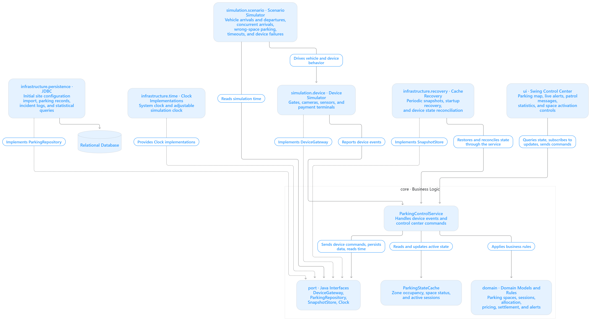
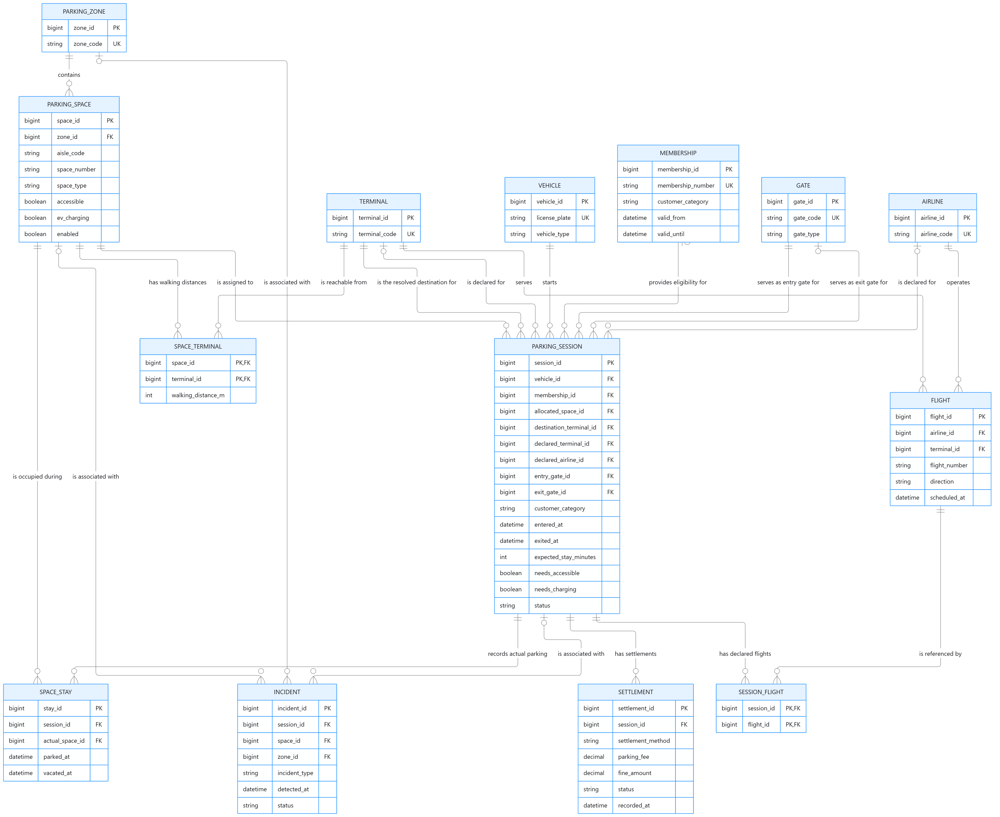

> Team 7: Hao Yang（76）、Zexuan Li、Haolin Chen

# Overall Architecture

| Member | Modules | Development responsibilities |
| --- | --- | --- |
| Member 1 | `core` | Develop the parking control service, allocate parking spaces, maintain the state cache, implement billing and payment settlement, define alert rules, and maintain the core interfaces. |
| Member 2 | `ui`, `infrastructure.persistence`, `infrastructure.recovery` | Develop the Swing control center for live alerts, patrol reports, and statistics. Implement initial data import, MySQL persistence, and crash recovery. |
| Member 3 | `simulation.device`, `simulation.scenario`, `infrastructure.time` | Simulate gates, cameras, sensors, and payment terminals. Provide an adjustable simulation clock and prepare the parking site configuration, flight data, and demonstration scenarios. |

The team will agree on the core interfaces and test them together through a complete vehicle entry, parking, billing, and exit workflow.

# MIA Parking Management System ER Diagram

# Key Challenges and Initial Approach

- **Concurrent space allocation.** Filter spaces by vehicle and user requirements, then rank them by terminal distance and flight urgency. During busy periods, spread assignments across aisles and reserve each space in a single operation to prevent double booking.
- **Accurate billing and alerts.** Use sensor timestamps to measure the time between parking and leaving the space. Use the same events to detect wrong-space parking and overdue stays.
- **Crash recovery.** Persist parking events and take periodic snapshots of the live cache. On restart, check restored sessions against device reports. Demonstrate recovery by stopping and restarting the JVM while vehicles are still parked.
- **Replaceable simulation.** Connect simulated devices through `DeviceGateway` and use a shared, adjustable `Clock` for both the core and the simulator. Keep the site layout in configuration so the team can add gates or zones without changing application code.
